# Smart Grind-by-Weight

[](docs/GRINDER_COMPATIBILITY.md)
[](sim/README.md)
[](https://github.com/Clinteastman/smart-grind-by-weight)
[](LICENSE)

Turn a compatible coffee grinder into a precise, touch-controlled
grind-by-weight system using a Waveshare ESP32-S3 AMOLED board and load cell.
Smart Grind learns the grinder's live flow and stopping delay, switches the
motor off before the target, then uses controlled pulses to finish the dose.

> **This is s31teg's fork** of the
> [community-maintained Smart Grind-by-Weight](https://github.com/Clinteastman/smart-grind-by-weight),
> which itself continues [Jaap Pieroen's original project](https://github.com/jaapp/smart-grind-by-weight).
> It adds the display, Start on Cup and finished-screen work listed below, and
> redrawn wiring diagrams for both board generations. Everything else matches
> the upstream release line, and the original authors remain credited.

**[What this fork adds](#what-this-fork-adds)** ·
**[Wiring diagrams](#wiring-diagrams)** ·
**[Installing this fork's firmware](#installing-this-forks-firmware)** ·
**[Build & installation guide](docs/DOC.md#start-here)** ·
**[Troubleshooting](docs/TROUBLESHOOTING.md)**

<table>
<tr>
<td width="50%">

https://github.com/user-attachments/assets/e20ce3e2-417e-4a3b-bb48-05591fce9418

</td>
<td width="50%">

[](media/smart-grind-by-weight-render.PNG)

</td>
</tr>
</table>

## What this fork adds

Screens below are rendered from the production firmware's UI code by the
[desktop simulator](sim/README.md).

<table>
<tr>
<td align="center" width="25%">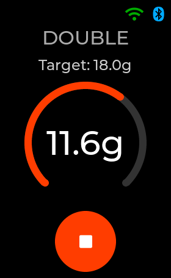<br><sub>Arc</sub></td>
<td align="center" width="25%">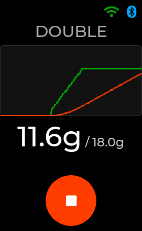<br><sub>Chart</sub></td>
<td align="center" width="25%">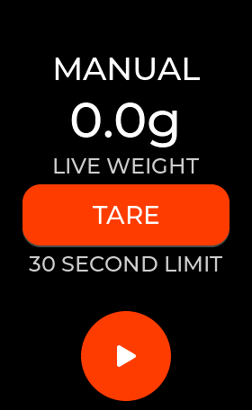<br><sub>Circle (new)</sub></td>
<td align="center" width="25%">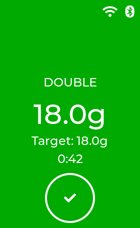<br><sub>Circle finished</sub></td>
</tr>
</table>

**Circle grind screen.** A third grinding layout: a circle grows with the dose
and the whole display turns green when the grind finishes, easy to read from
across the kitchen. Choose it under **Menu → Grind Settings → Grind Screen**,
or tap the grind screen to cycle Arc → Chart → Circle.

<table>
<tr>
<td align="center" width="25%">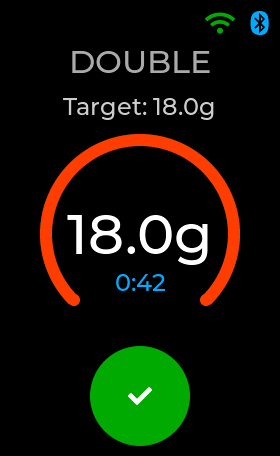<br><sub>Finished, timer counting</sub></td>
<td align="center" width="25%">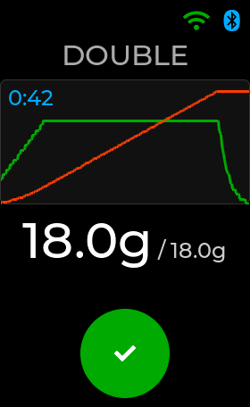<br><sub>Finished, chart layout</sub></td>
<td align="center" width="25%">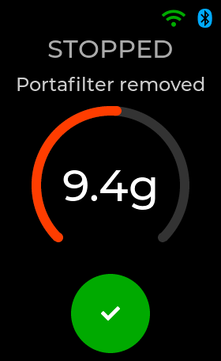<br><sub>Portafilter lifted</sub></td>
<td align="center" width="25%">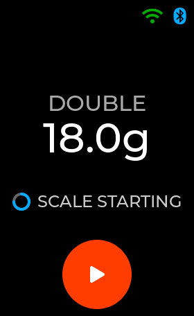<br><sub>Scale starting</sub></td>
</tr>
</table>

**Finished-screen timer.** After a grind the final weight stays on screen with
a timer counting up underneath, so you can see how long the grounds have been
waiting. Lifting the cup or portafilter stops the timer and starts the normal
**Show for** countdown. The screen stays awake while the timer runs, for up to
30 minutes.

**Stop when the portafilter is lifted.** Lifting the portafilter mid-grind
stops the motor in weight, time and manual modes, and the screen reads
**STOPPED · Portafilter removed** instead of a cryptic error.

**Scale starting.** For the first few seconds after power-on the profile pages
show **SCALE STARTING** and the Grind button waits, instead of failing with
"Could not start".

**Start on Cup that waits for the cup to settle.** The grinder remembers the
weight the scale last rested at and starts once the cup has come to rest at
least the threshold heavier. A heavy portafilter with a threshold close to its
own weight (for example 410 g against a 350 g threshold) no longer has to be
lifted off and set down again, and knocks or sensor noise only delay the start.

**Smoother V2 display.** V2 boards draw the next part of the screen while the
previous part is still being sent to the panel, so menus and animations run
faster. Redraws are aligned to the panel's even-row requirement, and the
status icons no longer cover text or buttons.

**Wi-Fi setup fixes.** The setup page shows the padlock for secured networks,
iPhones no longer autocorrect the network name, and a failed join says why:
network not found, password rejected, signal too weak and so on.

**Developer tooling.** The desktop simulator runs on macOS and Linux as well as
Windows, with layout checks that catch overlapping text before it reaches the
grinder. BLE delta updates pick the archive built for the matching board.

The full list is in the [changelog](CHANGELOG.md#unreleased).

## Wiring diagrams

Both board generations are redrawn from scratch, with every connection,
the grinder plug pinout and the brown-out capacitor. Click a diagram for the
full-size image; the editable SVG sources sit beside them in [`media/`](media/).

<table>
<tr>
<td width="50%"><strong>V1 hardware</strong> (original CO5300 display)<br><a href="media/wiring_diagram_v1.png">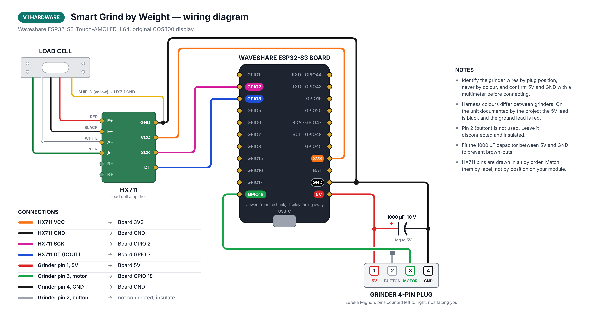</a></td>
<td width="50%"><strong>V2 hardware</strong> (SH8601 display, may be marked Rev1.1)<br><a href="media/wiring_diagram_v2.png">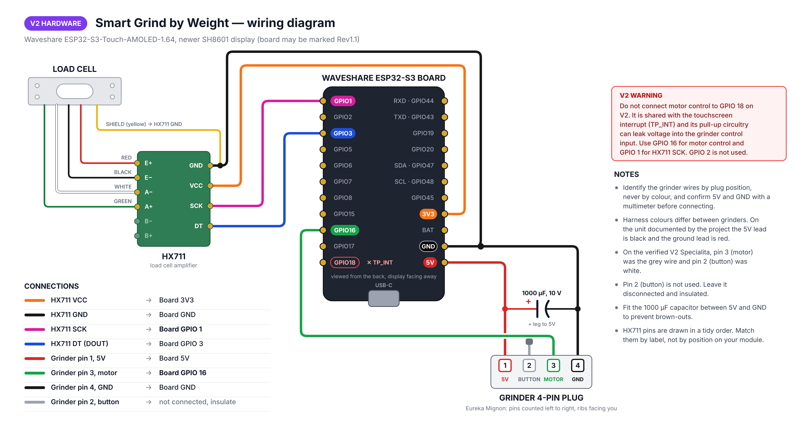</a></td>
</tr>
</table>

> [!WARNING]
> On V2 boards, never wire the motor to GPIO 18. It is the touchscreen's
> interrupt line. Use GPIO 16 for the motor and GPIO 1 for HX711 SCK. Identify
> the grinder wires by plug position, not colour, and confirm 5 V and GND with
> a multimeter first. The [installation guide](docs/HARDWARE_INSTALLATION.md#installation-and-wiring)
> has the full pin tables.

## Installing this fork's firmware

This fork does not publish releases, so build the firmware for your board and
upload it to the grinder:

```bash
# V2 board (use --hardware v1 for V1)
python3 tools/grinder.py build --hardware v2 --jobs 8

# Upload over Bluetooth
python3 tools/grinder.py upload
```

You can also upload the built `.bin` from the grinder's web page under
**System & updates → Manual firmware file**. Settings are kept across firmware
updates. See [DEVELOPMENT.md](docs/DEVELOPMENT.md) for the PlatformIO setup and
USB recovery.

> [!IMPORTANT]
> The grinder's one-click updater, the green update icon and the
> [web flasher](https://clinteastman.github.io/smart-grind-by-weight/) all
> install the **upstream** release. That replaces this fork's firmware and
> removes the features above until you upload this fork's build again.

> [!TIP]
> **Using Home Assistant?** Add automatic discovery, live local-push sensors,
> grinder controls and firmware-update reporting with the companion
> **[Smart Grind by Weight Home Assistant integration →](https://github.com/Clinteastman/smart-grind-home-assistant)**

## Features

- **Accurate grind-by-weight control** with predictive motor stopping,
  controlled finishing pulses and a configurable control tolerance of
  ±0.03 g.
- **Three editable profiles** for Single, Double and Custom doses, synchronized
  between the touchscreen and browser.
- **Target-free Manual mode** with one-tap start/stop, large optional live
  weight and TARE controls, elapsed time, motor-only lifetime accounting and an
  independent 30-second safety cutoff.
- **Grind-by-time mode** for the original timed workflow, including pause and
  resume and operation without a load cell.
- **Responsive AMOLED interface** with arc, chart and circle views, faster
  partial display updates and reliable short-swipe gestures.
- **Adjustable coast compensation** from 70% to 150%, stored on the grinder;
  the neutral 100% default preserves the original behaviour.
- **Automatic or manual motor-latency tuning** with a guarded 30–300 ms manual
  fallback on both the touchscreen and web interface when Pulse Tune cannot
  complete reliably.
- **Configurable automatic-start threshold** for cup or portafilter detection,
  editable from the touchscreen or web interface with the original 50 g
  behaviour retained by default.
- **Built-in screensavers** plus custom RGB565 image upload and an optional
  live GaggiMate status view, with configurable brightness, startup display
  and idle timeout. An optional second delay can turn the AMOLED panel fully
  off; leaving it disabled keeps the screensaver visible indefinitely.
- **Local Wi-Fi web app** with light/dark themes, live weight and flow, saved
  dose selection, round start/stop control, settings, grind history, analytics
  and data downloads.
- **Wi-Fi setup on the device** with network scanning, a secured captive portal,
  QR access, Improv Serial provisioning and `smartgrind.local` discovery.
- **One-click firmware updates from GitHub**, with automatic stable-release
  checks, a touchscreen update indicator and on-device installer, strict V1/V2
  image selection, plus manual Wi-Fi/Bluetooth upload and USB recovery.
- **On-device diagnostics** with downloadable retained startup/runtime logs.
- **Checked settings saves and stronger fault handling**, including runtime
  save confirmation, stale-scale stops and coordinated motor/update operations.
- **V1 and V2 Waveshare support**, reproducible CI builds, a public web flasher
  and a deterministic Windows, macOS and Linux desktop simulator for development.

Network clients request a selected-profile start or stop through the same grind
controller used by the touchscreen; they never drive the relay directly. The
firmware remains responsible for load-cell checks, state transitions and motor
safety.

## Web interface

The responsive web interface is served directly by the grinder at
`http://smartgrind.local`; no cloud account or separate application is needed.
Choose a saved dose, start or stop it with the round grind control, follow the
current grind, review its full recorded trace, change grinder/display settings
and install the latest stable firmware from a browser on the same network. The
System & updates page checks this project's GitHub releases and selects the
matching V1 or V2 application image automatically; manual upload remains
available as an advanced fallback. The grinder also checks in the background
while idle: a green refresh symbol appears when an update is ready, and either
that symbol or **Menu → Wi-Fi → Install update** starts the same guarded update
flow. If mDNS is unavailable, use the IP address shown on the grinder's Wi-Fi
screen.

<table>
<tr>
<td width="50%"><strong>Live dashboard</strong><br></td>
<td width="50%"><strong>Grind history</strong><br></td>
</tr>
</table>

<p align="center">
<strong>Grinder settings</strong><br>

</p>

The grinder retains the latest 10 logged sessions with accuracy, consistency,
weight and flow data. Each session can be downloaded as CSV, JSON or its
original raw record. BLE export and the Python analysis tools remain available
for longer-term archives and recovery workflows.

## Quick start

> [!CAUTION]
> This is an experimental mains-powered appliance modification. Disconnect the
> grinder from power before opening it, preserve protective earth and insulation,
> and ask a qualified person to handle mains wiring if you are not competent to
> do so. Build and use it at your own risk.

1. **Check compatibility and collect the parts.** Start with the
   [parts list](docs/HARDWARE_INSTALLATION.md#parts-list) and
   [grinder compatibility matrix](docs/GRINDER_COMPATIBILITY.md).
2. **Print the mounting parts.** Use the included STL files and review the
   [community 3D-print designs](docs/3D_PRINTS.md).
3. **Identify the controller generation before flashing.** The 1.64-inch V1
   and V2 boards require different display firmware and external GPIO wiring.
   Do not rely on the ambiguous `Rev1.1` PCB text alone; use the photographs and
   connector/component checks in
   [Display stays black after flashing](docs/TROUBLESHOOTING.md#display-stays-black-after-flashing-waveshare-164-v2).
4. **Flash the matching image.** Open the
   [Community Web Flasher](https://clinteastman.github.io/smart-grind-by-weight/)
   in Chrome or Edge on desktop/Android and explicitly select V1 or V2. That
   installs the upstream release; then
   [upload this fork's build](#installing-this-forks-firmware) over Bluetooth
   or Wi-Fi. USB recovery instructions and command-line alternatives are in the
   [development guide](docs/DEVELOPMENT.md).
5. **Wire, assemble and calibrate.** Follow the ordered
   [build and installation checklist](docs/DOC.md#start-here) and the
   [Eureka build video](https://youtu.be/-kfKjiwJsGM), using the
   [wiring diagram](#wiring-diagrams) for your board. On the verified V2
   installation, HX711 SCK is GPIO1 and the motor relay is GPIO16; GPIO18 is
   reserved by the touch controller.

The original timed mode remains available, and the documented Eureka
installation can be reversed without permanently modifying the grinder body.

For an uncomplicated target-free run, swipe to **Manual**, the first main-screen
page. If a scale is fitted, place the empty cup on it and tap **TARE**, then tap
**START**. Tap **STOP** when enough coffee has been ground. The large live weight
remains available before and after grinding. Manual mode never requires or
automatically tares the load cell and stops automatically after 30 seconds.

## How grinding works

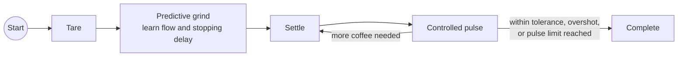

The controller learns flow and motor latency during each grind, predicts when
to stop before the requested weight, then evaluates the settled dose. Short,
bounded pulses finish an under-target dose without requiring a pre-trained bean
or grind-size profile. Coast compensation lets experienced users scale the
latency estimate while leaving the neutral default unchanged. **Menu → Tune
Pulses** remains the recommended way to measure minimum pulse latency; the same
stored value can be adjusted manually under **Grind Settings** when automatic
tuning is unavailable.

## Community development status

The released baseline supports both V1 and V2, with separate firmware builds.
The 1.5.8 candidate passed supervised V2 Wi-Fi installation, an 18 g grind with
saved history, and a live-settings check. Community V1 hardware testing is
welcome. See [release validation](docs/RELIABILITY_RELEASE.md) for coverage limits.

| Stage | Status | Outcome |
| --- | --- | --- |
| V1/V2 maintained baseline | Complete | Tested firmware targets, V2 wiring, simulator and faster/reliable display gestures |
| Public web flasher and releases | Complete | Explicit controller-generation selection and downloadable, reproducible V1/V2 packages |
| Wi-Fi provisioning and safe OTA | Complete | Reliable setup, `smartgrind.local` discovery, one-click stable-release updates and manual full-image upload |
| Shared live device API | Complete | Bounded 10 Hz WebSocket feed, correlated controller-backed grind/profile/tare requests, settings and history APIs |
| Live grinder web UI | Complete | Dashboard, live/completed graphs, settings, history/analytics, downloads, OTA and screensavers |
| Native Home Assistant integration | Complete | [Separate Zeroconf/local-push integration](https://github.com/Clinteastman/smart-grind-home-assistant), validated in Home Assistant 2026.8 against physical V2 hardware with correlated safe commands and a separate user-present one-second protocol motor acceptance |

The [community roadmap](docs/COMMUNITY_ROADMAP.md) records the detailed delivery
status, reviewed upstream work and contribution plan. The independently
implemented [Wi-Fi, Web and Home Assistant architecture](docs/WIFI_ARCHITECTURE.md)
uses lessons from mature ESP32 appliance projects without copying their source.

## Development and contributing

See [DEVELOPMENT.md](docs/DEVELOPMENT.md) for the PlatformIO targets, simulator,
tests and contribution workflow. Build and flash operations use a project lock,
and V1/V2 compiled-object caches are isolated to prevent board-specific LVGL
objects from mixing.

The complete editable Fusion 360 design is included at
`3d_files/smart-grind-by-weight. Eureka Mignon.f3z`.

Please report reproducible problems through
[GitHub Issues](https://github.com/Clinteastman/smart-grind-by-weight/issues),
including the board generation, firmware version and a diagnostic log where
possible, and say if you are running this fork. Tested V1 hardware feedback is
particularly useful.

## Credits

- This fork is maintained by [s31teg](https://github.com/s31teg). Its changes
  are also offered upstream as pull requests to
  [Clinteastman/smart-grind-by-weight](https://github.com/Clinteastman/smart-grind-by-weight/pulls?q=author%3As31teg).
- The community-maintained release line this fork builds on is maintained by
  [Clinteastman](https://github.com/Clinteastman).
- Smart Grind-by-Weight was originally created by
  [Jaap Pieroen (@jaapp)](https://github.com/jaapp). This fork retains Jaap's
  original commit history and remains licensed under GPLv3. The
  [upstream README](https://github.com/jaapp/smart-grind-by-weight#readme)
  preserves the original author's project introduction and personal note.
- v1.5 incorporates reviewed contributions from
  [Randy1st](https://github.com/Randy1st),
  [Woutifier](https://github.com/Woutifier),
  [quickcoffee](https://github.com/quickcoffee) and
  [FleischerT](https://github.com/FleischerT). See the
  [v1.5 changelog](CHANGELOG.md#community-contributions) for the source PRs.
- The project was inspired by
  [openGBW](https://github.com/jb-xyz/openGBW) by jb-xyz and
  [Coffee Grinder Smart Scale](https://besson.co/projects/coffee-grinder-smart-scale)
  by Besson.

## Releases and license

Read the versioned [changelog](CHANGELOG.md), download tested builds from
[Community Releases](https://github.com/Clinteastman/smart-grind-by-weight/releases),
or consult the [original release archive](https://github.com/jaapp/smart-grind-by-weight/releases).

Smart Grind-by-Weight is free software distributed under the
[GNU General Public License v3.0 or later](LICENSE).
